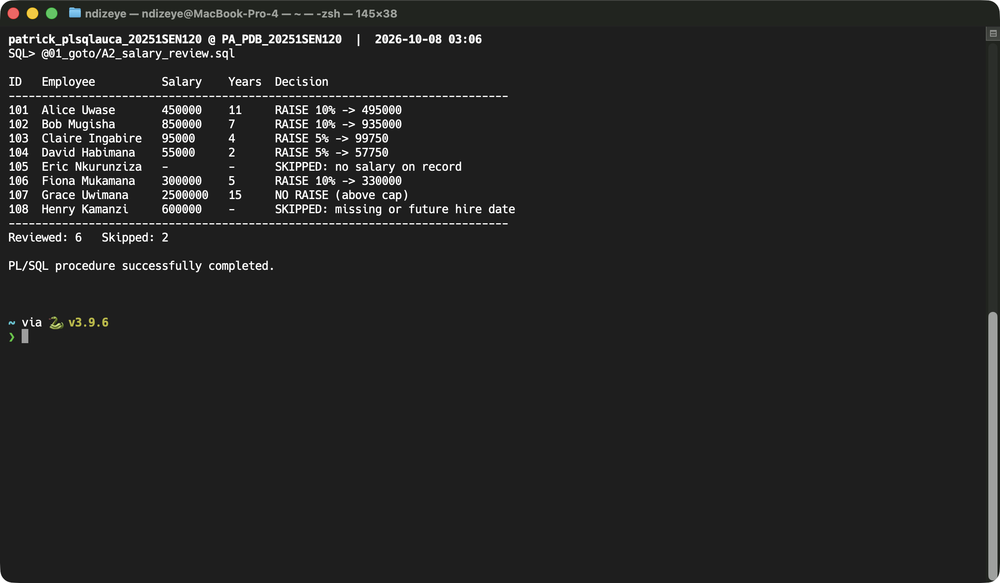
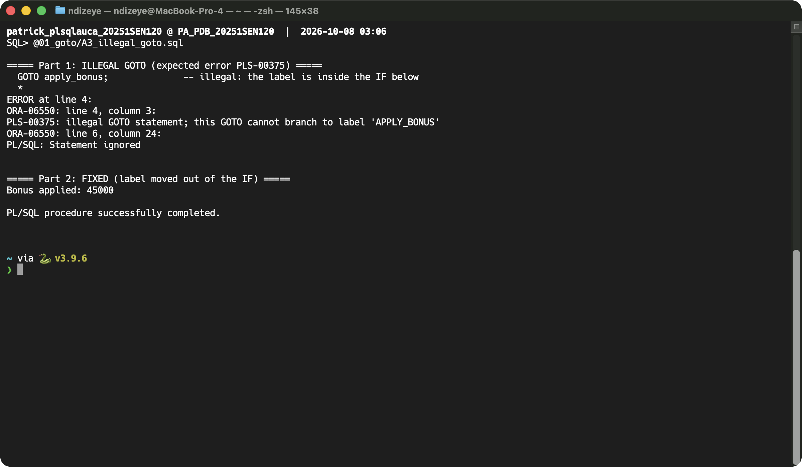
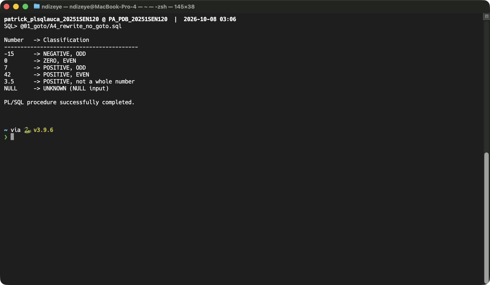
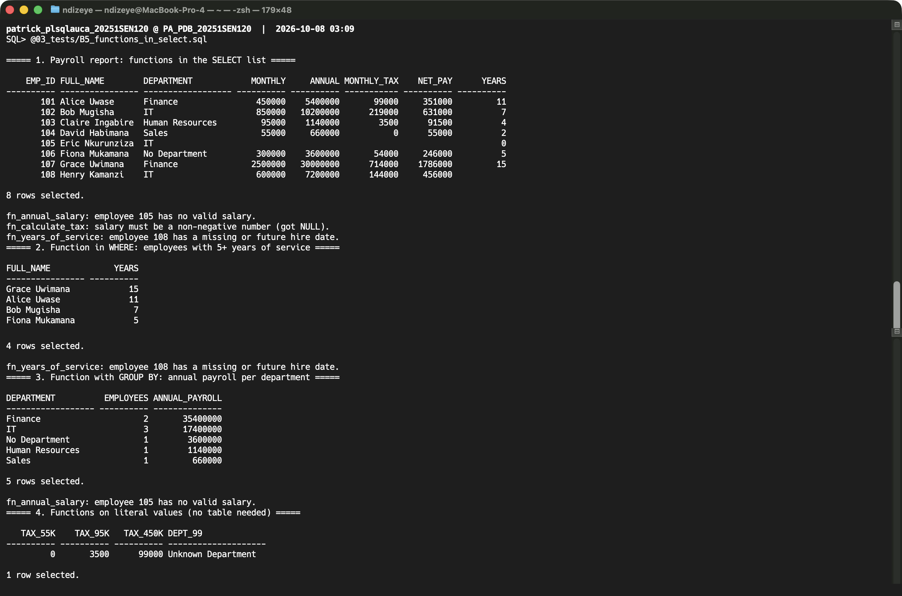
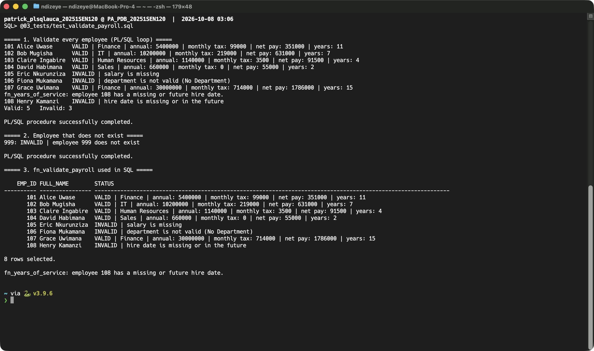

# PL/SQL GOTO Statements and Functions

**Individual Assignment III — Database Development with PL/SQL (INSY 8311)**

| | |
|---|---|
| Student | Patrick |
| Student ID | 20251SEN120 |
| Instructor | Eric Maniraguha |
| Database | Oracle Database 21c Express Edition (21.3) |
| Schema | `PATRICK_PLSQLAUCA_20251SEN120` in PDB `PA_PDB_20251SEN120` |
| Tool | Oracle SQL Developer 26.2 |

## Overview

This repository covers PL/SQL `GOTO` statements, stored functions, exception handling, and calling functions from SQL. Everything runs on two tables: `DEPARTMENTS` and `STAFF`.

`STAFF` contains five valid employees and three problem rows, so the validation logic has real cases to catch:

| emp_id | Problem |
|---|---|
| 105 | no salary |
| 106 | no department |
| 108 | hire date in the future |

Salaries are **monthly gross amounts in RWF**.

## Repository Structure

```
plsql-goto-functions-20251SEN120-patrick/
├── README.md
├── .gitignore
├── 00_setup/
│   └── create_tables.sql            -- DEPARTMENTS + STAFF with test data
├── 01_goto/
│   ├── A1_number_classifier.sql     -- classify numbers using GOTO
│   ├── A2_salary_review.sql         -- skip bad records with GOTO
│   ├── A3_illegal_goto.sql          -- PLS-00375 and the fix
│   └── A4_rewrite_no_goto.sql       -- A1 rewritten without GOTO
├── 02_functions/
│   ├── B1_fn_annual_salary.sql
│   ├── B2_fn_years_of_service.sql
│   ├── B3_fn_calculate_tax.sql
│   ├── B4_fn_dept_name.sql
│   └── C1_fn_validate_payroll.sql
├── 03_tests/
│   ├── B5_functions_in_select.sql
│   ├── test_functions.sql
│   └── test_validate_payroll.sql
├── screenshots/
└── docs/
    └── REFLECTION.md
```

## How to Run

Connect as `PATRICK_PLSQLAUCA_20251SEN120` (service `pa_pdb_20251SEN120`). Run each file with **Run Script (F5)** in SQL Developer, or with `@file.sql` in SQL\*Plus.

1. `00_setup/create_tables.sql`
2. `02_functions/`: B1 → B4 first, then C1 (C1 calls the B functions)
3. `01_goto/`: A1 → A4
4. `03_tests/`: `test_functions.sql`, `B5_functions_in_select.sql`, `test_validate_payroll.sql`
5. Compare the output with the expected results below and with the screenshots.

`SET SERVEROUTPUT ON` is at the top of every file. Without it, `DBMS_OUTPUT` prints nothing.

## Part A — GOTO

**GOTO rules applied in this part:**
- A label (`<<name>>`) must be followed by an executable statement. When nothing should happen there, use `NULL;`.
- A `GOTO` may jump within the same sequence of statements, or **out of** an `IF`, a `LOOP` or a nested block.
- A `GOTO` may **not** jump **into** an `IF`, a `LOOP` or a nested block, between `IF` branches, or from an exception handler back into the body. Any of these gives `PLS-00375`.

### A1 — Number Classifier
Classifies each number in a list (`-15, 0, 7, 42, 3.5, NULL`) as NEGATIVE, ZERO or POSITIVE, and as EVEN, ODD or not a whole number. Each sign jumps to its own label. All three then jump to a shared `<<parity>>` label, and finally to `<<show_result>>`. NULL input jumps straight to `<<unknown>>`.


### A2 — Salary Review
Loops over `STAFF` and proposes a raise for each employee:

| Condition | Decision |
|---|---|
| 5 or more years of service | 10% raise |
| 1 to 4 years of service | 5% raise |
| Less than 1 year | no raise (probation) |
| Salary ≥ 2,000,000 | no raise (above cap) |

Records with no salary, or with a missing or future hire date, are skipped with `GOTO skip_employee`. Every path ends at `<<next_employee>> NULL;`. This is a report only: no data is changed.

**Expected:** Reviewed 6, Skipped 2 (employees 105 and 108).



### A3 — Illegal GOTO and Fix
Part 1 jumps **into** an `IF` block and fails with:
```
PLS-00375: illegal GOTO statement; this GOTO cannot branch to label 'APPLY_BONUS'
```
Part 2 fixes it. The label moves **outside** the `IF`, and the `GOTO` now jumps *out of* the `IF` to reach it, which is legal. It prints `Bonus applied: 45000`.



### A4 — Rewrite Without GOTO
A1 rewritten with a `CASE` expression, `IF/ELSIF`, and `CONTINUE` for the NULL case. The output is identical to A1. Without labels, the logic reads top to bottom.



## Part B — Functions

Every function:
- uses `IN` parameters typed with `%TYPE`;
- validates its input;
- handles `NO_DATA_FOUND`, its own user-defined exceptions, and `OTHERS`.

When something is wrong, a function prints a message and **returns NULL instead of raising an error**, so it can be used safely inside a `SELECT`.

| Function | Returns | Error handling |
|---|---|---|
| **B1** `fn_annual_salary(p_emp_id)` | monthly salary × 12 | NULL for a missing employee, or a NULL / ≤ 0 salary |
| **B2** `fn_years_of_service(p_emp_id)` | complete years worked: `TRUNC(MONTHS_BETWEEN(SYSDATE, hire_date) / 12)` | NULL for a missing employee, or a missing / future hire date |
| **B3** `fn_calculate_tax(p_monthly_salary)` | monthly PAYE tax, using progressive brackets | NULL for a NULL or negative salary |
| **B4** `fn_dept_name(p_dept_id)` | department name | `'No Department'` for a NULL ID; `'Unknown Department'` for an ID not in the table (`NO_DATA_FOUND`) |

**B3 tax brackets** (each rate applies only to the part of the salary inside its bracket):

| Monthly salary (RWF) | Rate |
|---|---|
| 0 – 60,000 | 0% |
| 60,001 – 100,000 | 10% |
| 100,001 – 200,000 | 20% |
| above 200,000 | 30% |

Example: 450,000 → 0 + 4,000 + 20,000 + 75,000 = **99,000**.

### B5 — Functions in SQL
`03_tests/B5_functions_in_select.sql` calls the functions directly inside SQL:
- in the `SELECT` list (a full payroll report);
- in `WHERE` (employees with 5 or more years);
- with `GROUP BY` (annual payroll per department);
- on literal values from `DUAL`.

This works because each function returns a SQL datatype and performs no DML.



## Part C — Combined Task

### C1 — Payroll Validator
`fn_validate_payroll(p_emp_id)` combines `GOTO` with the B functions. Each rule that fails sets a reason and runs `GOTO invalid_payroll`. A record that passes every rule returns its payroll summary.

Rules, checked in order:
1. The employee exists.
2. The salary is present and between 50,000 and 5,000,000.
3. The department is valid (uses `fn_dept_name`).
4. The hire date is present and not in the future (uses `fn_years_of_service`).

Sample output:
```
101 Alice Uwase      VALID | Finance | annual: 5400000 | monthly tax: 99000 | net pay: 351000 | years: 11
105 Eric Nkurunziza  INVALID | salary is missing
106 Fiona Mukamana   INVALID | department is not valid (No Department)
108 Henry Kamanzi    INVALID | hire date is missing or in the future
999: INVALID | employee 999 does not exist
```
**Expected:** Valid 5, Invalid 3.



### C2 — Reflection
See [`docs/REFLECTION.md`](docs/REFLECTION.md).

## Notes

**AI assistance:** I used an AI assistant (Claude) while doing this assignment. It helped me:
- set up the Oracle 21c environment on my Mac;
- draft the SQL and PL/SQL in this repository;
- draft the reflection in `docs/REFLECTION.md`, based on what happened while I did the work, which I then reviewed and edited;
- run each script against my database to check that it compiles and produces the expected output.

I reviewed every file, ran all the scripts myself in SQL Developer for the screenshots, and can explain how each program and function works.

**Assumptions:** the assignment lists task titles only, so the specific rules above are my own choices, documented in each file's header comments:
- the raise policy (A2);
- the tax brackets (B3), which follow Rwanda's PAYE structure;
- the payroll validation rules (C1).
